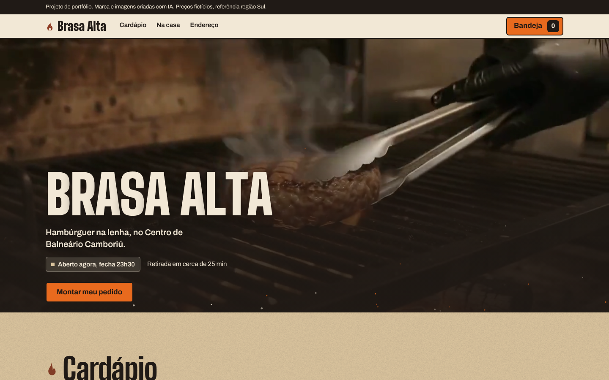
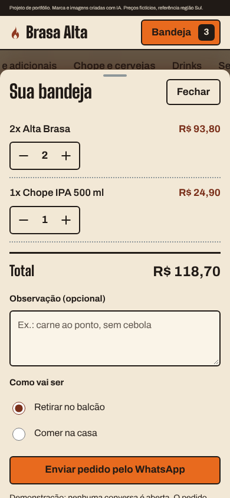
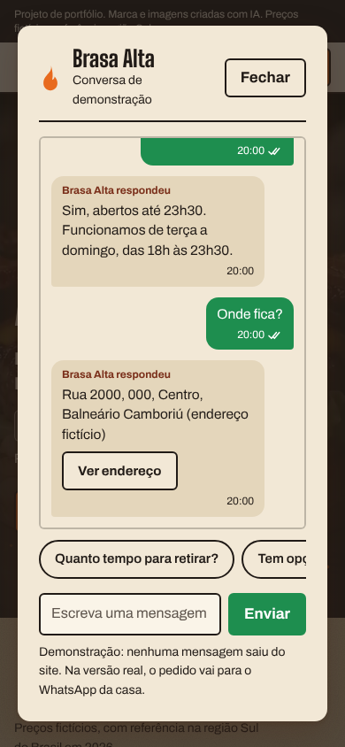
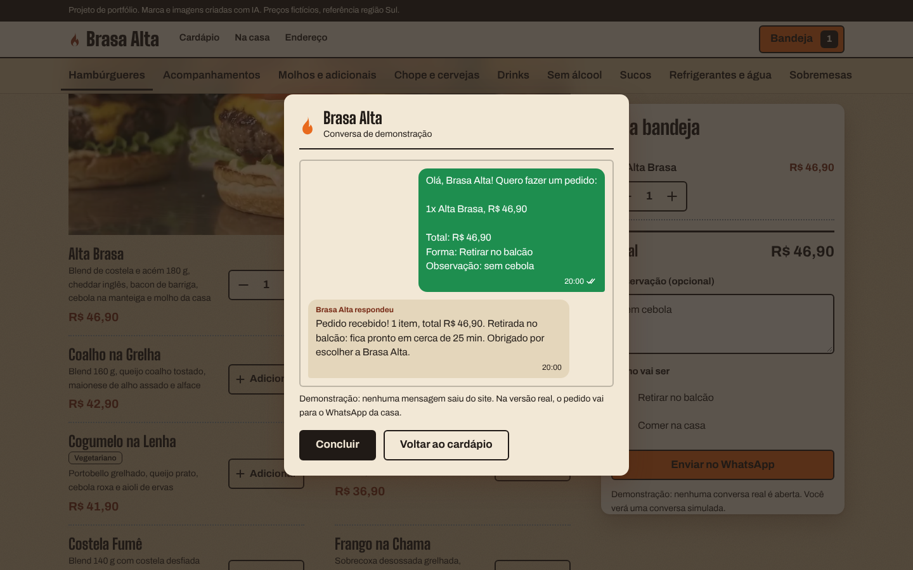
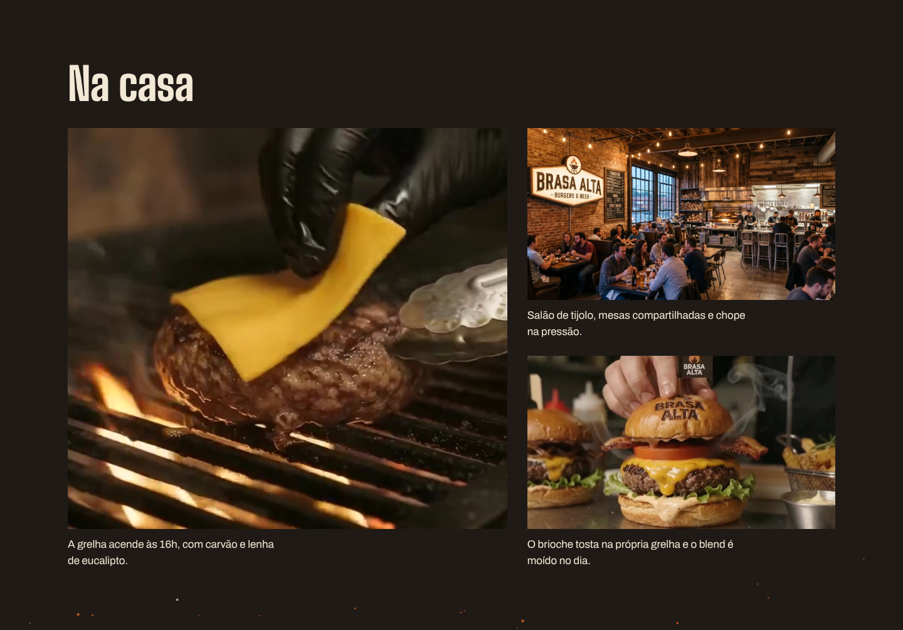

# Brasa Alta

Site conceitual de uma hamburgueria fictícia na brasa, com cardápio, busca, pedido montável e atendimento simulado por mensagem. Projeto de portfólio de Diego Arruda.

**Ver no ar:** https://portfolio-brasa-alta.pages.dev

> Brasa Alta é uma marca fictícia. Marca, imagens e vídeo foram criados com IA. Endereço e preços são fictícios, com referência em hamburguerias artesanais da região Sul do Brasil em 2026. Nenhuma mensagem sai do site.



## O que o site faz

- **Cardápio de 51 itens em 9 categorias**, gerado a partir de uma lista de dados, com barra de categorias fixa que acompanha a rolagem.
- **Busca** sem acento e sem diferenciar maiúsculas, por nome, descrição, categoria e etiqueta.
- **Bandeja de pedido**: o botão Adicionar vira controle de quantidade, chopes com seletor de 300 e 500 ml, total em tempo real, observação e forma de retirada. No celular, a bandeja é uma folha arrastável com mola.
- **Envio simulado**: o pedido vira uma conversa com resposta da casa, que muda conforme o horário de Brasília, a forma de retirada e a presença de bebida alcoólica.
- **Chat com respostas prontas**: horário calculado na hora, endereço, tempo de retirada, opções vegetarianas e chopes, tudo lido dos mesmos dados do cardápio.
- **Desfazer** com 10 s, atalho Ctrl+Z ou Cmd+Z e acesso pelo teclado.

| Bandeja no celular | Chat com respostas prontas |
|---|---|
|  |  |



## Decisões de design

- **Conceito:** o papel kraft da bandeja vira a página. O vídeo da grelha abre o site e o cardápio aparece logo na primeira rolagem.
- **Tipografia:** Big Shoulders Display nos títulos, condensada como o letreiro pintado, e Archivo no texto. Fontes servidas pelo próprio site.
- **Paleta:** fuligem `#201A16`, kraft `#D8C29C`, papel `#F2E8D6`, tijolo `#7A2F1A`, brasa `#E86A1E`.
- **Movimento:** trechos do comercial viram fotos vivas que só tocam quando estão na tela, brasas em canvas, título que sobe letra a letra e um disco que voa até a bandeja ao adicionar. Tudo para com a preferência "reduzir movimento" do sistema.
- **Cara de produto:** linhas de cardápio impresso em vez de cartões, estados reais (vazio, removido, desfazer, nada encontrado) e textos escritos como um cardápio de verdade.



## Acessibilidade e qualidade

- Contraste verificado por par de cores (WCAG), alvos de toque de 44 px, foco visível, uma única região de anúncio para leitor de tela.
- Testado no Chrome em 320, 360, 390, 768 e 1440 px e em paisagem, sem rolagem horizontal e sem erros no console.
- Revisão independente em três rodadas.

## Tecnologia

HTML, CSS e JavaScript puros, sem framework e sem dependência externa em tempo de execução. Hospedagem na Cloudflare Pages.

```text
site/
├── index.html
├── styles.css
├── script.js
├── fonts/   Big Shoulders Display e Archivo (SIL Open Font License)
├── img/
└── media/   vídeo de 12 s e trechos curtos em loop
```

Para abrir localmente, basta abrir `site/index.html` no navegador.

## Como foi feito

Marca, fotos e vídeo gerados com IA. A pesquisa de preços e de cardápio que embasou os valores está em [pesquisa-cardapio.md](pesquisa-cardapio.md).

---

Diego Arruda, [drasdiego.com.br](https://drasdiego.com.br)
